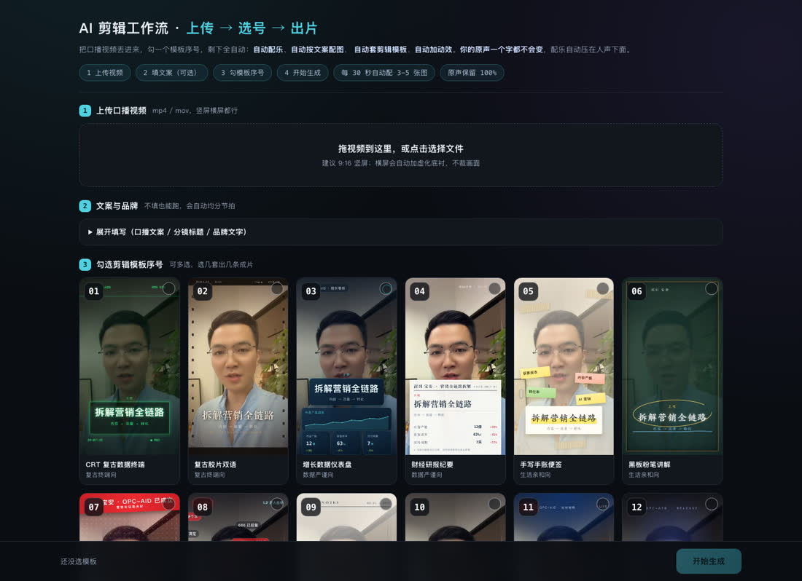
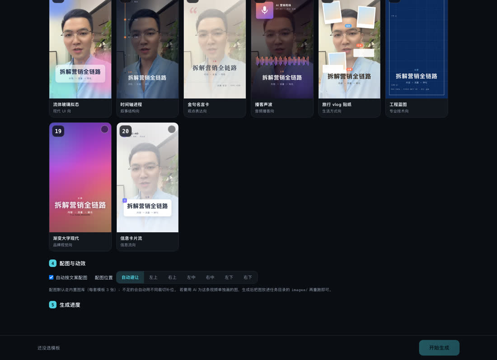

# video-editing-studio · 口播短视频自动剪辑工作台

> 拖一段口播视频进来 → 勾一个模板序号 → 出来一条带动效、配乐、配图、字幕的成片，
> 外加一张抖音爆款封面图。**口播原声与口型一个字都不变。**



配图位置不是写死的角落：每套模板的落点都按自己的版面算过（避开标题卡、底部信息条与人脸），
默认「自动避让」；想整片统一方位也可以一键切成左上 / 右上 / 左中 / 右中 / 左下 / 右下。



## 为什么值得用

大多数"AI 剪辑"的做法是把画面重生成一遍——结果是**换脸、换声、改口型**，
因为视频模型只拿到一张静帧，拿不到你的原片和音轨。

这个工作台换了条路：**原片做底，网页动效层叠上去。**

| | 云端重生成方案 | 本工作台 |
|---|---|---|
| 口播原声 | ❌ 模型生成的声音 | ✅ **原声逐样本保留**（互相关 ≥ 0.94） |
| 口型同步 | ❌ 靠静帧猜 | ✅ **就是原片画面**，完全同步 |
| 时长 | ❌ 常被模型截断到 5-15s | ✅ **完整时长**，多长都行 |
| 平台水印 | ❌ 常带"AI 生成"标识 | ✅ 无 |
| 出片成本 | 按次计费 | ✅ **全本地**，一条视频几百 MB 磁盘 |

## 功能

- **20 套动效模板**：CRT 复古终端 / 财经研报 / 电商大字报 / 流体玻璃拟态 / 工程蓝图 …… 见下方清单
- **自动分节拍**：填了口播稿就按标点切句，没填就按时长均分
- **自动配图**：30 秒 3-5 张、60 秒 6-10 张，按文案主题取材，带 Ken Burns 缓动与淡入淡出
- **运镜**：主画面缓慢推近 / 拉回，幅度可调也可关
- **圆圈画中画**：讲完一段后**主画面缩成一个小圆圈、背景换成配图**（博主模板里最常见的那个），
  落点跟着人脸走，圆圈半径恒不超过缩略画面的内切圆，永不漏黑底
- **自动出封面**：截成片首帧 + 从标题文案里提炼**一行大字 + 一行小字**，抖音爆款版式（3:4 / 9:16），
  并附一份给 OpenAI Image / 香蕉用的底图重画提示词
- **专属 BGM**：每套模板一条独立配乐（NumPy 从零合成，无版权问题），人声出现时自动退让
- **一键出多版**：多选模板序号 = 一条视频出多条不同风格成片
- **自带质检**：成片与原片做音频包络互相关，低于 0.9 直接说明原声被动了
- **网页工作台**：拖拽上传、编号选模板、实时进度、在线播放与下载

## 快速开始

```bash
git clone <this-repo> && cd video-editing-studio

python3 scripts/doctor.py          # 环境自检，缺什么它会直接告诉你
python3 scripts/server.py --open   # 起工作台，自动打开 http://127.0.0.1:8760
```

需要在网页上做的三件事：**拖视频进来 → 勾模板序号 → 点「开始生成」**。

依赖只有三个包（Python 3.8+）。**建议装在虚拟环境里**，别污染系统 Python：

```bash
python3 -m venv .venv && source .venv/bin/activate    # 推荐：隔离环境

python3 -m pip install numpy playwright imageio-ffmpeg
python3 -m playwright install chromium
```

> 不需要单独安装 `ffmpeg`——用的是 `imageio-ffmpeg` 自带的静态二进制。
> `scripts/doctor.py` 会检测上面这些，缺什么直接告诉你补哪一条（它只打印建议，不会自己执行安装）。

## 命令行用法

```bash
cd scripts

# 一条视频出两个风格
python3 pipeline.py --input=某视频.mp4 --styles=glass,promo --out=我的任务

# 带口播稿，节拍与配图都跟着文案走
python3 pipeline.py --input=某视频.mp4 --styles=crt \
  --script="中国有个地方叫深圳，那里有个区叫宝安。OPC-AID 正式成立了。"

# 用竖线分隔分镜标题，直接指定每一拍的字幕
python3 pipeline.py --input=某视频.mp4 --styles=news \
  --titles="深圳 · 宝安|OPC-AID 已成立|拆解营销全链路|让 AI 营销落地"

# 调版式用单帧预览，几秒出图，不用等整片
python3 preview.py --job=我的任务 --styles=glass --times=4.6,10.6,16.2 --pos=tr
python3 preview.py --job=我的任务 --styles=glass --pip=off --zoom=0    # 关运镜与圆圈

# 运镜与圆圈画中画（主画面缩成小圆圈、背景换配图）
python3 pipeline.py --input=某视频.mp4 --styles=glass --pip=all --zoom=0.11 --pip-r=172
python3 pipeline.py --input=某视频.mp4 --styles=glass --zooms=2            # 整片推拉 2 次
python3 pipeline.py --input=某视频.mp4 --styles=glass --pip=off --zoom=0   # 不要运镜
```

`--pip=auto`（默认）隔一个配图节拍做一次圆圈，且开场 1.5s 内不做、圆圈总时长不超过全片 45%。
**推拉运镜整片只做一次**（`--zooms`，默认 1），放在最长的一段空档里对半切开——前半推近、后半拉回；
圆圈本身已经在缩放，推拉一多就晕。`--zoom` 默认 `0.075`（放大 7.5%），`--pip-r` 默认 `150`；
整链用 `--no-covers` 可以不出封面。

### 封面图（也可以单独重出，不动成片）

```bash
python3 cover.py --job=我的任务 --styles=glass                    # 3:4 + 9:16
python3 cover.py --job=我的任务 --styles=glass --layouts=bottom,top
python3 cover.py --job=我的任务 --styles=glass --big="3步搞定获客" --small="AI 替你干活"
python3 cover.py --job=我的任务 --styles=glass --no-kicker         # 只留一行大字一行小字
```

封面文案是**规则提炼**出来的：正文（拆解 / 方案 / 行动）比片头片尾的过场句得分高，
带数字和力度词（免费 / 揭秘 / 成本 / AI…）再加分，配图用的空镜描述永远只当兜底。
想改字改色直接打开 `covers/cover.html`（双击即可，改的就是 `covers/cover_cfg.js`）。

## 20 套模板

| 号 | id | 名称 | 分组 | 号 | id | 名称 | 分组 |
|---|---|---|---|---|---|---|---|
| 01 | `crt` | CRT 复古数据终端 | 复古终端向 | 11 | `news` | 新闻播报台 | 时事权威向 |
| 02 | `retro` | 复古胶片双语 | 复古终端向 | 12 | `product` | 产品发布官网 | 科技发布向 |
| 03 | `dash` | 增长数据仪表盘 | 数据严谨向 | 13 | `glass` | 流体玻璃拟态 | 现代 UI 向 |
| 04 | `report` | 财经研报纪要 | 数据严谨向 | 14 | `timeline` | 时间轴进程 | 叙事结构向 |
| 05 | `journal` | 手写手账便签 | 生活亲和向 | 15 | `quote` | 金句名言卡 | 观点表达向 |
| 06 | `chalk` | 黑板粉笔讲解 | 生活亲和向 | 16 | `podcast` | 播客声波 | 音频播客向 |
| 07 | `promo` | 电商促销大字报 | 商业热度向 | 17 | `travel` | 旅行 vlog 贴纸 | 生活方式向 |
| 08 | `danmu` | 弹幕评论流 | 商业热度向 | 18 | `blueprint` | 工程蓝图 | 专业技术向 |
| 09 | `magazine` | 杂志编辑排版 | 出版编辑向 | 19 | `gradient` | 渐变大字现代 | 品牌视觉向 |
| 10 | `minimal` | 极简纪录片章节 | 出版编辑向 | 20 | `card` | 信息卡片流 | 信息流向 |

## 输出规格

| 项 | 值 |
|---|---|
| 画面 | 720×1280 / 30fps / H.264（横屏原片自动加模糊底衬，不裁画面） |
| 音频 | AAC 192k / 48kHz / 立体声，口播原声为主轨 |
| 响度 | -15 LUFS / 真峰值 -1.7 dBFS（先测量后补增益 + 限幅） |
| 质检 | 与原片音频包络互相关，正常 ≥ 0.93 |

## 目录结构

```
video-editing-studio/
├── SKILL.md                    WorkBuddy agent 用的技能说明
├── scripts/
│   ├── paths.py                路径解析（引擎位置 / 产物工作区解耦）
│   ├── server.py               网页工作台服务（纯标准库）
│   ├── pipeline.py             一键流水线
│   ├── autobeat.py             自动分节拍 + 配图张数规划
│   ├── camera.py               运镜 + 圆圈画中画（关键帧 → ffmpeg 表达式 / 浏览器计划）
│   ├── cover.py                抖音爆款封面（首帧 + 文案提炼 + 排版截图）
│   ├── music_gen.py            20 套模板的配乐合成器
│   ├── preview.py              单帧预览（调版式用）
│   ├── doctor.py               环境自检
│   └── build_assets.py         素材压缩（开发用）
├── assets/
│   ├── gallery.html            全部模板的 CSS 皮肤 + 绘制函数 + 配图层 + B-roll 挖洞
│   ├── cover.html              封面版式页（可单独打开手改）
│   ├── templates.json          唯一可编辑的配置源
│   ├── templates.js            由 json 生成的浏览器版本
│   ├── web/index.html          上传选号前端
│   ├── thumbs/                 20 张模板缩略图
│   └── library/                60 张内置配图
├── references/
│   ├── templates.md            模板系统与扩展方法
│   ├── architecture.md         渲染/音频管线设计
│   └── troubleshooting.md      排错手册
├── deploy/
│   ├── install.sh              云服务器一键部署（Ubuntu/Debian/阿里云 Linux）
│   └── README.md               机器选型 / 安全组放行 / 运维 / 排错
└── docs/                       README 配图
```

产物写在 `~/VideoStudio`（可用 `VIDEO_STUDIO_WORKSPACE` 换盘），
**不污染仓库目录**。

## 加自己的模板

一套模板 = 一段 `#L_<id>` CSS 皮肤 + 一个 `S.<id> = {build, fit, draw}` 绘制函数。
配图层实现一次、20 套共享，所以加模板完全不用碰配图逻辑。
完整步骤见 [`references/templates.md`](references/templates.md)。

## 给 WorkBuddy / Claude Code 当技能用

本仓库就是一个标准 skill 包。装到用户级技能目录即可：

```bash
git clone <this-repo> ~/.workbuddy/skills/video-editing-studio
```

之后直接说「帮我把这个口播视频剪一下，用 13 号模板」就会触发。

## 已知限制

- 逐帧渲染是 CPU 密集的：20 秒视频一套模板约 1-2 分钟，60 秒约 4-6 分钟。任务串行排队，不建议并行。
- 配图落点已逐套校准（避开标题卡、底部信息条与人脸，稳定落在画面四角）；换了模板或改了版式后若发现挤到内容，用 `--image-pos` 或改该套的 `imageLayer.xy` 微调。
- 运镜与圆圈画中画是在**原片上做缩放与位移**，不是重新生成画面；圆圈里露出的仍是原片（跟着人脸锚点）。
  锚点靠肤色掩膜估出来的，人脸不在画面上中位置时会退回默认点，用 `--pip=off` 可整体关掉。
- 封面文案是**规则提炼**，不会替你无中生有写钩子。想要更狠的标题就用 `--big/--small` 手填，
  或走 `covers/ai_prompts.json` 让 OpenAI Image / 香蕉重画底图。
- 无头浏览器不渲染 emoji，模板与封面文案一律用纯文字。
- 只做"整片包装"，不做真正的剪辑点合并（把多个片段剪成一条）。

## 安全说明

- **全本地运行**：不上传任何素材到外部服务，不调用任何云端 API。
  唯一的网络动作是前后端在 `127.0.0.1` 上的本地通信。
- **服务默认只监听本机** `127.0.0.1:8760`。
- **带访问口令**：设了 `STUDIO_PASS` 之后所有请求都要 HTTP Basic 认证，
  没口令连首页都打不开（口令用常数时间比较，防逐位试探）。
  **没设口令时不允许监听公网**——`--host=0.0.0.0` 而没设口令会直接拒绝启动，
  避免"以为在本地、其实全网可访问"。
- **路径穿越已拦截**：所有静态文件请求都经过 `safe_child()` 限制在各自根目录内
  （`/media/library/../../..` 这类请求返回 404）。
- **子进程只调用本机二进制**：`ffmpeg`（来自 `imageio-ffmpeg`）与 Playwright 自带的
  Chromium，命令参数是列表形式、不经 shell，不接受远程输入。
- **删除操作只作用于自己的工作区**：中间文件（`frames/*.mov`、`preview_tmp/`）
  在 `~/VideoStudio` 内创建和清理，不触碰工作区之外的任何文件。

## 部署到云服务器（阿里云 ECS）

想摆脱本机、用手机或公司电脑出片，可以装到一台公网服务器上：

```bash
git clone https://github.com/lijianguo1121-bit/video-editing-studio.git /tmp/vs
cd /tmp/vs
sudo STUDIO_PASS='你的访问密码' bash deploy/install.sh
```

脚本自动装依赖（含**中文字体**，没它中文全是方框）、建专用用户、装无头 Chromium、
注册 systemd 服务、放行本机防火墙，最后打印访问地址。可重复执行 = 更新 + 重启。

**还要在阿里云控制台放行安全组**（否则外网打不开）：
ECS → 安全组 → 配置规则 → 入方向 → 放行 TCP `8760`。

机器建议 **2 核 4G 起**（渲染是 CPU 密集，不需要 GPU，2 核机器上 20s 视频约 3-6 分钟）。
完整步骤、手动安装、排错表见 [`deploy/README.md`](deploy/README.md)。

## License

MIT
